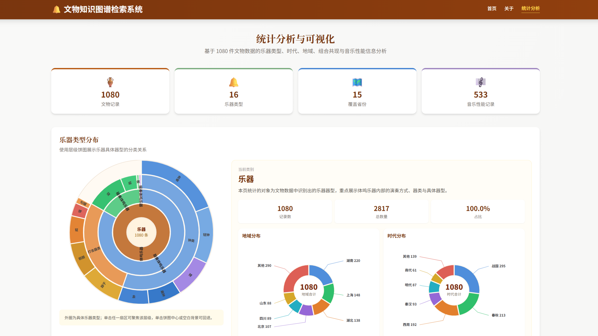
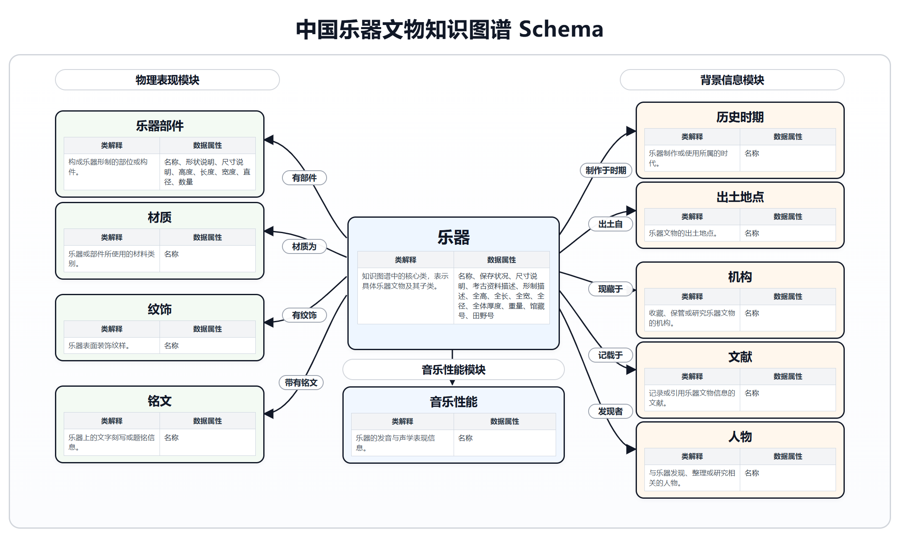
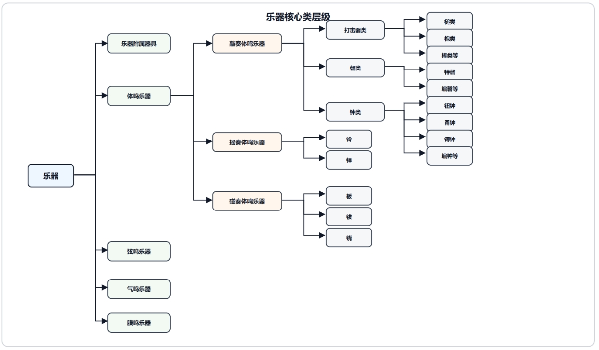
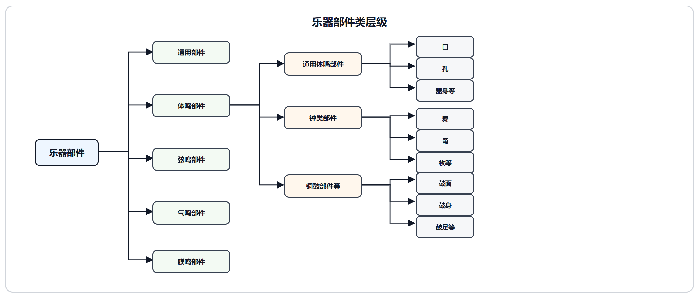
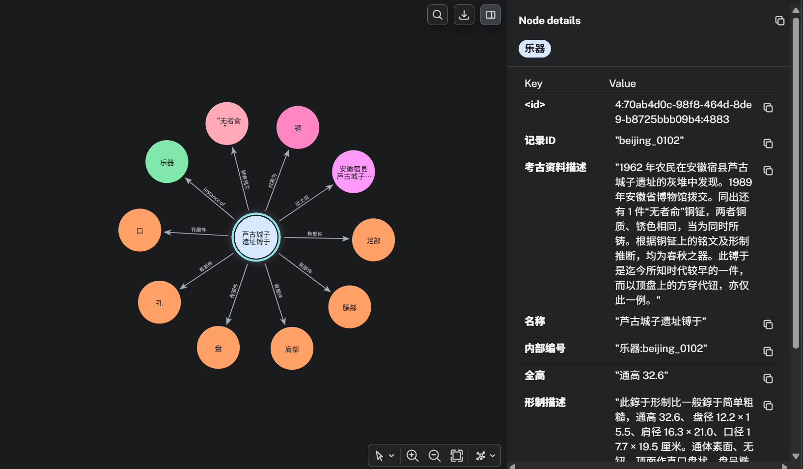
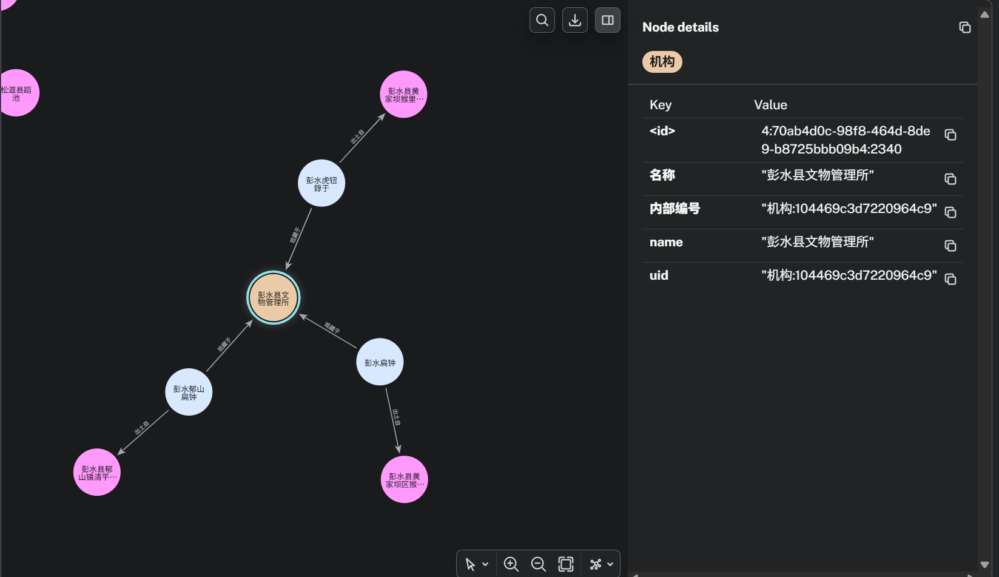

# 중국 전통 악기 유물 지식그래프

[English](README.md) | [한국어](README.ko.md) | [简体中文](README.zh-CN.md)

해당 프로젝트는 지식그래프 수업에서 진행한 팀프로젝트입니다.

**프로젝트에 관한 간략한 설명:**
중국 전통 악기 도서에서 데이터를 추출하고, 온톨로지 기반 지식그래프를 구축하는 프로젝트입니다. MinerU로 스캔형 PDF를 텍스트로 변환하고 일부 데이터에 수동 라벨링을 수행한 뒤, 규칙 추출과 BERT 계열 모델의 개체명 인식·관계 추출을 결합해 데이터를 구조화했습니다. LLM 기반 추출은 비교 실험으로 평가했으며, 최종 데이터는 통계 시각화와 유물 검색을 지원하는 데모 웹사이트로 연결했습니다.

[데모 웹사이트 바로가기](https://traditional-instruments-knowledge-g.vercel.app/)

## 웹사이트 언어 지원

상단 언어 메뉴에서 中文, English, 한국어를 선택할 수 있습니다. 선택한 언어는 페이지 이동과 새로고침 후에도 유지되며, 기본 언어는 중국어입니다. 메뉴, 필터, 상세 정보 항목, 차트·툴팁, 악기 분류, 일반적인 시대명 및 지역명을 번역했습니다. `상하이 용종`, `Shanghai Yongzhong`처럼 한국어·영어 분류명으로도 검색할 수 있습니다.

## 프로젝트 개요

**문제정의:** 중국 전통 악기 유물의 형태·출토지·시대·소장 정보가 문헌의 개별 항목에 분산되어 있어, 조건에 맞는 유물을 찾거나 유물 간 관계를 함께 살펴보기 어렵다. 이 프로젝트는 문헌 속 기술을 연결 가능한 데이터로 정리하는 데 초점을 맞췄다.

**해결방법:** 《中国音乐文物大系》의 자료를 정리하고, 악기와 부품·재질·문양·시대·장소·기관 등을 온톨로지로 모델링했다. 팀은 규칙 추출과 BERT 기반 엔터티 인식·관계 추출을 결합해 그래프를 구축했으며, Vue와 D3 기반 데모에서 결과를 탐색하도록 구현했다.

**결과물 활용:** 사용자는 키워드와 지역·악기 유형 등의 조건으로 유물 레코드를 검색하고, 상세 속성·추출 결과·유사 유물을 조회할 수 있다. 차트에서는 악기 유형·지역·시대 분포와 출토지 기준 공출현을 살펴볼 수 있다.

- 주요 결과물: 1,080개 레코드의 데모 데이터, 온톨로지 Schema, 그래프 DB 덤프, 검색·시각화 웹 데모.
- 개인 담당: OCR, 데이터 전처리, 데이터 라벨링, 온톨로지 구축, BERT 모델링·훈련 참여.
- 프로젝트 성격: 완료된 수업 팀 프로젝트.

## 주요 결과 및 대표 이미지

웹 데모는 검색·필터링, 유물 상세 조회, 유사 유물 추천을 제공한다. 통계 화면에서는 악기 유형·지역·시대 분포와 출토지 기준 공출현을 탐색할 수 있다. 아래 그림은 웹 데모, 온톨로지 설계, Neo4j 탐색 결과를 보여준다.

### 그림 1. 악기 유형·지역·시대별 통계 대시보드



1,080개 유물 레코드의 규모와 분포를 요약한 화면이다. 계층형 원형 차트로 악기 분류를, 도넛 차트로 지역·시대별 분포를 살펴볼 수 있다. 화면의 레코드 수와 실물 수량은 서로 다른 집계다.

### 그림 2. 악기를 중심으로 연결한 지식그래프 Schema



악기를 중심으로 부품·재질·문양·명문, 역사 시기·출토지·기관·문헌·인물, 음악 성능을 연결한 구조다. 각 클래스의 데이터 속성과 클래스 사이의 관계를 함께 보여준다.

### 그림 3. 체명악기를 세분화한 악기 클래스 계층



지식 추출 보고서에 수록된 악기 클래스 계층이다. 체명·현명·기명·막명악기 등의 상위 분류를 두고, 실제 연구 대상인 체명악기는 연주 방식과 종·경 등의 세부 유형으로 나눴다. 전체 온톨로지의 설계 범위는 이번 데모의 체명악기 데이터 범위보다 넓다.

### 그림 4. 부품 명칭을 표준화한 클래스 계층



악기 부품을 공통 부품과 악기군별 부품으로 구분하고, 체명악기는 종과 동고 등의 부품으로 세분화했다. 문헌의 부품 표현을 공통 개념에 연결하고 부품별 치수·형태 속성을 정리하기 위한 기준이다.

### 그림 5. 개별 유물의 부품·재질·출토지 연결



하나의 유물을 선택했을 때 연결된 부품, 구리 재질, 명문, 출토지를 확인하는 Neo4j 탐색 사례다. 오른쪽 패널에는 기록 ID, 고고학적 기술, 형태·치수 등의 속성이 표시된다.

### 그림 6. 소장 기관을 공유하는 유물과 출토지 탐색



동일한 소장 기관에 속한 여러 악기와 각각의 출토지를 연결해 보여준다. 기관에서 유물로, 유물에서 출토지로 관계를 따라가며 자료를 탐색할 수 있다. 그림 5·6은 별도 Neo4j/Cypher 탐색 화면이다.

## 개인 기여도

- OCR: 이미지형 PDF 도서에 MinerU를 적용해 중국어 텍스트를 추출했다.
- 데이터 전처리: OCR 결과의 문단·필드를 정리하고 유물별 기록으로 나누어 라벨링과 모델 입력 데이터를 준비했다.
- 데이터 라벨링: Label Studio 기반 수동 라벨링에 참여했다.
- 온톨로지 구축: classical-music 온톨로지 프레임워크를 참고하고 Protégé를 사용해 도메인 개념과 관계를 모델링하는 작업에 참여했다.
- BERT 모델링: BERT 계열 모델을 활용한 개체명 인식·관계 추출 모델링 및 훈련에 참여했다.

## 데이터 및 전처리

데이터 출처는 《中国音乐文物大系》의 15개 지역권이다. 최종 데이터는 체명악기 중심의 유물 레코드 1,080개이며, 이 중 533개에 음악 성능 정보가 포함되어 있다. 보고서 기준 실물 수량 합계는 2,817점이다. 한 레코드가 여러 실물 유물을 기술할 수 있으므로 레코드 수와 실물 수량은 구분한다.

원자료는 문자가 이미지로 저장된 스캔형 PDF 도서다. MinerU로 중국어 OCR 및 문서 레이아웃 분석을 수행한 뒤, Python으로 텍스트를 정리하고 유물별로 기록을 나눴다. 필드 형식을 통일한 텍스트를 Label Studio에 입력하고, 湖北卷·北京卷의 체명악기 기록 총 206건을 수동 라벨링했다.

`src/data/artifacts.json`에는 유물명·악기 유형·시대·기관·출토지·문헌 등의 기본 필드와 `标注部分`의 원문·엔터티·관계 항목이 들어 있다. 엔터티는 텍스트·라벨·시작 및 끝 위치를, 관계는 주체·객체·유형·신뢰도 값을 담는다. 레코드 1,080개의 ID는 모두 고유하다.

아래는 [실제 JSON 원본](https://github.com/Heisenberg0607/traditional-instruments-knowledge-graph/blob/main/src/data/artifacts.json)의 첫 번째 레코드에서 주요 필드만 발췌한 한 줄 예시다. 엔터티·관계와 나머지 필드는 생략했다.

```json
{"record_id": "shandong_0017", "器物名称": "青州苏埠屯8号墓编铙", "乐器类型": "铙", "数量": "3", "时代": "商代晚期", "机构": "山东省文物考古研究所", "出土地点": "青州苏埠屯8号商代墓"}
```

이 레코드는 상나라 말기 칭저우 쑤부툰 8호묘 출토 편요(编铙) 3점을 하나의 기록으로 기술하며, 악기 유형·시대·소장 기관·출토지를 함께 제공한다.

## 구축 방법 및 시스템 구조

| 단계 | 사용 방법과 역할 |
| --- | --- |
| 문헌 디지털화 | 이미지형 PDF 도서에 MinerU의 중국어 OCR·레이아웃 분석을 적용해 기계가 읽을 수 있는 텍스트로 변환 |
| 전처리·수동 라벨링 | Python으로 텍스트 정리·유물별 기록 분할·필드 형식 통일 후 Label Studio에서 수동 라벨링 |
| 온톨로지 모델링 | classical-music 온톨로지 프레임워크를 참조하고 Protégé를 사용하여 악기·부품·재질·문양과 역사·출토 맥락을 연결 |
| 규칙 기반 추출 | 유물명·유형·시대·기관·출토지·번호·문헌 등 형식이 비교적 일정한 기록 단위 필드를 추출 |
| BERT 개체명 인식 | `hfl/chinese-roberta-wwm-ext`와 BIOES·CRF로 악기 부품·문양·데이터 속성·기관·출토지의 5개 유형을 인식 |
| BERT 관계 추출 | 엔터티 쌍에 `[E1]`·`[E2]` 마커를 붙여 RoBERTa에 입력하고 전체 치수·부품 치수·수량·형태 설명 등의 관계를 분류 |
| 규칙 후처리 | 중복 제거·필드 병합·전체 및 부품 속성 검증·번호 형식 보호·장소 경계 보정 등을 수행 |
| LLM 비교 실험 | Qwen2.5-7B 및 Qwen3-14B의 프롬프트·5-shot·미세조정 설정을 비교하고 최종 추출에는 규칙 + BERT 방식을 채택 |
| 그래프 구축 | 엔터티와 관계를 온톨로지에 맞춰 통합하고 Neo4j 그래프 DB에 저장하여 Cypher로 탐색 |
| 웹 탐색 | Vue 3·Vue Router로 화면 구성, Pinia로 데이터 관리, D3로 분포·관계 시각화 |

처리 흐름은 **스캔형 PDF → MinerU OCR → 텍스트 전처리 → 일부 기록 수동 라벨링 → 규칙 + BERT 추출 → 규칙 후처리 → 온톨로지에 따른 그래프·JSON 구성 → 검색·시각화**다. 온톨로지는 라벨링·추출·그래프 구성에 사용하는 공통 개념과 관계의 기준이며, LLM은 추출 방법 비교 실험에 사용했다.

웹 데모는 로컬 JSON을 읽는 구조다. 검색에는 문자열 매칭을 사용하고, 유사 유물 추천은 부품 중복도 0.4·문양 중복도 0.4·시대 근접도 0.2의 가중 합을 사용한다. 이 가중치는 추천 규칙의 구성값이다.

## 평가 방법 및 결과

### 평가 기준

지식 추출 보고서 4~6장의 실험 결과를 기준으로 Precision(정밀도), Recall(재현율), F1을 정리했다. 아래 성능 수치는 모두 백분율(%)이다. BERT 실험은 데이터를 학습·검증·테스트 8:1:1로 나눴다. NER의 엄격 평가는 엔터티 경계·유형의 일치를, RE는 주체·객체·관계 유형의 일치를 기준으로 한다.

LLM 실험은 엄격 매칭과 완화 매칭을 구분했다. 완화 매칭은 라벨이 같고 규칙에 부합하면 단위나 일부 접두·접미 표현에 따른 경계 차이를 허용한다. BERT NER의 5개 유형은 부품·문양·데이터 속성·기관·출토지이고, LLM NER의 5개 유형은 악기·부품·출토지·데이터 속성·기관이다. 따라서 아래 값은 각 실험 설정의 결과이며, 동일한 라벨·평가셋을 전제로 한 직접 순위 비교로 해석하지 않는다.

### BERT 계열 모델 결과

| 평가 대상 | 설정 | Precision | Recall | F1 |
| --- | --- | ---: | ---: | ---: |
| 개체명 인식(NER) | BIOES + RoBERTa + CRF | 77.27 | 75.22 | **76.23** |
| 관계 추출(RE) | 표준 엔터티를 입력한 RoBERTa 관계 분류 | 72.00 | 94.74 | **81.82** |

NER F1은 BIO + RoBERTa 기준선 71.00%에서 BIOES 적용 시 73.00%, CRF 추가 시 76.23%로 향상되었다. 최종 모델은 기준선 대비 **5.23%p** 개선되었다. 유형별로는 출토지 F1 94.12%, 문양 85.71%였으나 기관은 50.00%로 보완이 필요했다.

### LLM 결과

| 평가 대상 | 모델·설정 | Precision | Recall | F1 |
| --- | --- | ---: | ---: | ---: |
| NER | Qwen2.5-7B, 단순 프롬프트·미세조정 없음 | 24.79 | 37.04 | 29.70 |
| NER 엄격 매칭 | Qwen3-14B, 프롬프트 최적화 + 5-shot | 47.61 | 60.72 | **53.37** |
| NER 완화 매칭 | Qwen3-14B, 프롬프트 최적화 + 5-shot | 56.46 | 72.01 | **63.29** |
| NER 엄격 매칭 | Qwen3-14B, 프롬프트 최적화 + 5-shot + 미세조정 | 45.67 | 57.89 | 51.06 |
| NER 완화 매칭 | Qwen3-14B, 프롬프트 최적화 + 5-shot + 미세조정 | 55.88 | 70.83 | 62.48 |
| RE, 표준 엔터티 입력 | Qwen2.5-7B, 단순 프롬프트·미세조정 없음 | 8.06 | 13.89 | 10.20 |
| RE, 표준 엔터티 입력 | Qwen3-14B, 프롬프트 최적화 + 5-shot | 87.62 | 84.79 | 86.18 |
| RE, 표준 엔터티 입력 | Qwen3-14B, 보고서의 미세조정/배포 버전 | 88.32 | 85.14 | **86.70** |

### 예측 엔터티를 사용하는 파이프라인 평가

위 RE 표는 정답 엔터티가 주어진 조건이다. 실제 처리처럼 NER의 예측 엔터티를 RE에 전달하면 오류가 다음 단계로 전파되므로 이를 별도로 구분했다.

| 평가 대상 | 입력·조건 | Precision | Recall | F1 |
| --- | --- | ---: | ---: | ---: |
| BERT 파이프라인 RE | NER 예측 엔터티 입력 | 미기재 | 미기재 | **약 5.56** |
| Qwen3-14B 파이프라인 NER | 엄격 매칭 | 46.47 | 60.95 | 52.73 |
| Qwen3-14B 파이프라인 NER | 완화 매칭 | 55.77 | 73.14 | 63.28 |
| Qwen3-14B 파이프라인 RE | NER 예측 엔터티 입력 | 28.15 | 35.02 | **31.21** |

두 계열 모두 엔터티 경계 오류가 관계 추출 성능을 크게 낮췄다. 최종 구축에서는 출력의 안정성·재현성·수정 용이성을 고려하여 **규칙 추출 + BERT 추출 + 규칙 후처리**를 선택했다. 위 파이프라인 수치는 각각 보고된 모델 실험 결과이며, 최종 규칙 결합 방식의 정확도를 나타내는 별도 평가값은 보고서에 제시되지 않았다.

### 데이터·산출물 규모

| 확인 대상 | 근거 | 결과 |
| --- | --- | --- |
| 데모 JSON 규모 | `src/data/artifacts.json` 직접 집계 | 레코드 1,080개, 엔터티 항목 23,394개, 관계 항목 8,951개 |
| 문헌·실물 범위 | 지식 추출 보고서 | 15개 지역권, 실물 수량 합계 2,817점, 음악 성능 정보 포함 레코드 533개 |
| 수동 라벨링 | 지식 추출 보고서 | 湖北卷·北京卷 체명악기 기록 총 206건 |
| 그래프 문서 규모 | `docs/schema/classes.csv`의 기재값 | 악기 노드 1,170개 |

엔터티·관계 항목 수는 반복 언급을 포함한 파일 구성 규모다. 그래프의 악기 노드 수, 데모 레코드 수, 실물 수량은 집계 대상이 다르다. 모델의 추출 성능과 웹 검색·추천 품질 역시 별도 평가 대상이며, 검색·추천의 정량 평가는 후속 과제다.

## 설치 및 실행

Node.js와 npm이 있는 환경에서 저장소 루트의 터미널로 실행한다.

```bash
npm ci
npm run dev
```

```bash
npm run build
npm run preview
```

개발 화면은 Vite가 출력하는 주소에서 연다. 웹 데모는 포함된 JSON으로 실행된다. 그래프 DB 자료는 [덤프 파일](data/graph/知识图谱文件.dump), 탐색 예제는 [Cypher 쿼리](docs/queries.cypher)와 [그림이 포함된 Word 원본](docs/original/cypher-queries.docx)에서 확인할 수 있다. DB 복원은 별도의 Neo4j 환경에서 진행한다.

## 주요 디렉터리 구조

```text
src/
  data/artifacts.json
  stores/artifactStore.js
  utils/statisticsData.js
  views/
data/graph/
  知识图谱文件.dump
docs/
  images/
  schema/
    classes.csv
    relations.csv
  original/
    final-poster.pptx
    cypher-queries.docx
  queries.cypher
package.json
package-lock.json
README.md
README.ko.md
README.zh-CN.md
```

## 한계 및 개선 방향

- 재현 범위: 현재 공개 자료는 결과 데이터·그래프 덤프·설계 문서·탐색 데모를 중심으로 구성되어 있다. OCR·추출 단계까지 재현하려면 처리 코드와 실행 설정을 함께 정리할 필요가 있다.
- 데이터 정합성: 데모 레코드와 그래프 노드의 집계 범위를 맞추고, 원문·라벨·추출 결과의 이력을 연결하는 작업이 필요하다.
- 평가: 보고서에 BERT·LLM 추출 평가가 포함되어 있으나, 라벨 체계·평가셋을 통일한 비교와 최종 규칙 결합 파이프라인의 별도 평가가 필요하다. OCR 및 검색·추천 품질의 정량 평가도 후속 과제다.
- 통계 해석: 지역은 휴리스틱으로 추정하며 수량 미상은 1로 처리한다. 문헌 수록 범위와 집계 규칙을 함께 고려해야 한다.

## 참고 자료 및 이용 조건

- [기말 포스터 원본](docs/original/final-poster.pptx)
- [Cypher 탐색 사례 및 그래프 화면](docs/original/cypher-queries.docx)
- [핵심 클래스 Schema](docs/schema/classes.csv) · [관계 Schema](docs/schema/relations.csv)
- 문헌 출처: 《中国音乐文物大系》.

수업 팀 프로젝트의 공동 결과물이다. 문헌 데이터·이미지·코드의 이용 및 재배포는 각 자료의 권리와 팀의 합의 범위에 따라야 한다.
