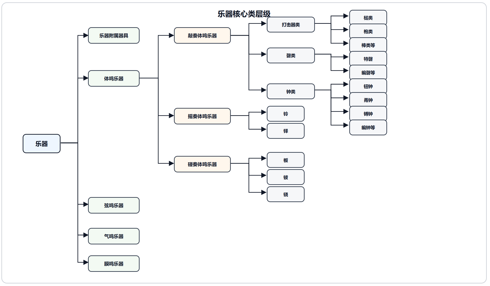

# Traditional Chinese Musical Instrument Artifact Knowledge Graph

A course team project that structures archaeological descriptions through BERT-based named entity recognition and LLM-based relation extraction, connecting a domain ontology and knowledge graph to a search and visualization demo.

[English](README.md) | [한국어](README.ko.md) | [简体中文](README.zh-CN.md)

## Website languages

Choose 中文, English, or 한국어 in the header. The selection persists across navigation and reloads; Chinese remains the default. Navigation, filters, detail labels, chart labels/tooltips, instrument classifications, common periods, and province names are localized. Search accepts English and Korean instrument, period-group, province, and decoration names alongside the original Chinese text (for example, `Shanghai Yongzhong` or `상하이 용종`).

In English, artifact names, holding/former institutions, and excavation sites combine translated domain terms with untoned pinyin for proper names, followed by the original Chinese in parentheses. For example: `Yishui Liujiadianzi Zheng Bell (沂水刘家店子钲)`. Extracted instrument parts, shapes/dimensions, and decoration tags also have English labels with Chinese originals, including relation subjects and objects. Numeric-only measurements stay unchanged. Period labels include Yinxu phases, early/middle/late subdivisions, and regnal dates. Where a period field contains an entire archaeological paragraph, the English identifies the period cited and explicitly notes that additional source notes are retained. Full source text remains in parentheses. These English labels are searchable. The Chinese display is unchanged; full archaeological narratives and citations retain their source text.

The original dataset and filter/grouping identifiers are unchanged. UI translations live in `src/i18n/messages.tsv` (Chinese source, English, Korean; tab-separated). Record labels live in `src/i18n/english-records.json`, generated offline with `npm run generate:english-records`. The generator in `scripts/generate-english-records.mjs` contains vocabulary and pronunciation overrides for review; generated pinyin and literal institution labels are display aids, not claims of official English names. Regenerate the catalog when adding records or changing overrides. The pinyin dictionary is a development dependency and is not sent to visitors. Run `npm run test:i18n` to check translation coverage, original-text preservation, Chinese display stability, and multilingual search, and `npm run build` for a production build.

Annotation and period labels live in `src/i18n/english-annotations.json`. Regenerate them with `npm run generate:english-annotations`; vocabulary and exact phrase overrides are in `scripts/annotation-glossary.mjs`. Short descriptions use a context-specific glossary and literal phrase composition; broken source fragments are identified as such. Bell anatomy follows the [Smithsonian bell-parts guide](https://asia-archive.si.edu/wp-content/uploads/2017/07/Resound-Large-print.pdf) and [National Palace Museum terminology](https://theme.npm.edu.tw/selection/Article.aspx?lang=2&sNo=04001042). Tests require coverage of every current part, attribute, decoration, relation endpoint, and period while checking that source strings and the Chinese display remain unchanged.

Korean content follows the same Chinese-original format. Established Korean instrument terms and explanatory anatomy/shape labels are combined with Hangul transliteration for place/proper names, plus historical-name overrides. Examples: `종의 자루 (甬)`, `상나라 은허 말기 (商代殷墟晚期)`, and `산둥성 문물고고연구소 (山东省文物考古研究所)`. Korean names, metadata, anatomy, descriptions, and periods are searchable. `npm run generate:korean` builds `src/i18n/korean-content.json` from the reviewed glossary, transliteration rules, and existing content catalogs. Build-time files `scripts/korean-glossary.mjs`, `scripts/pinyin-hangul.mjs`, and `scripts/generate-korean.mjs` maintain exact phrase/name overrides and literal phrase composition. The transliteration uses the NIKL initial/final correspondence approach with explicit conventional-name exceptions; uncommon names and source fragments remain reviewable through their Chinese originals. Tests also check full Korean coverage, bilingual originals, decimal preservation, and existing English/Chinese behavior.

## Project Overview

Problem: descriptions of traditional Chinese musical instrument artifacts are scattered across documentary entries, making it difficult to find artifacts by their attributes and examine their relationships together. The project turns these descriptions into connected, structured data.

Approach: the team organized material from 《中国音乐文物大系》 and modeled instruments, parts, materials, decoration, periods, locations, and institutions with a domain ontology. BERT identifies entities and an LLM extracts semantic relations for graph construction, while a Vue and D3 demo makes the results explorable.

What You Can Do: search and filter artifact records by keywords, region, and instrument type, then inspect attributes, extraction results, and similar artifacts. Charts support exploration of instrument-type, regional and period distributions, and co-occurrence by excavation location.

- Main outputs: a 1,080-record demo dataset, ontology schemas, a graph database dump, and a search and visualization web demo.
- My role: OCR, data preprocessing, data annotation, and ontology construction.
- Project type: completed course team project.

## Main Outputs and Images

The web demo provides search, filtering, artifact details, and similarity recommendations. Visualizations cover instrument-type hierarchies, regional distribution, a region-by-type heatmap, type distributions across periods, and instrument co-occurrence by excavation location. Separate Cypher materials illustrate individual artifact relationships and connections between excavation locations and holding institutions.

The images below come from the team's original demo, schema diagrams, and Cypher document. The instrument and part hierarchies show a broader ontology design scope than the demo's idiophone focus.





## My Contribution

- OCR: handled character recognition for the source material.
- Data preprocessing: organized source material and prepared data for subsequent work.
- Data annotation: contributed to annotation of the documentary data.
- Ontology construction: contributed to structuring domain knowledge through ontology construction.

## Data and Preprocessing

The data comes from 《中国音乐文物大系》. The poster highlights the Hubei, Beijing, and Shaanxi volumes as representative sources. The demo JSON also includes records from other regions.

Document organization and annotation support joint exploration of artifact metadata and text-based extraction results. `src/data/artifacts.json` contains fields such as artifact name, instrument type, period, institution, excavation location, and literature, alongside entity and relation entries. Entities contain text, labels, and offsets. Relations contain subjects, objects, types, and confidence values.

All 1,080 records have unique IDs. A record may describe multiple physical objects, so record counts and object counts are distinct.

## Methods and System Structure

| Stage | Method and role |
| --- | --- |
| Document organization and annotation | Organize unstructured descriptions and prepare data for entity recognition |
| Ontology modeling | Reference the classical-music ontology framework to connect instruments, parts, materials, decoration, and historical and excavation contexts |
| BERT named entity recognition | Identify instrument names, periods, materials, forms, excavation locations, and holding locations in documentary text |
| LLM relation extraction | Extract semantic relations linking instruments to periods, regions, materials, uses, and literature sources |
| Graph construction | Integrate entities and relations in a Neo4j graph database for Cypher exploration |
| Web exploration | Vue 3 and Vue Router for views, Pinia for data management, and D3 for distribution and relationship visualizations |

The web demo reads local JSON. Search uses string matching. Similarity recommendations combine part overlap with weight 0.4, decoration overlap with weight 0.4, and period proximity with weight 0.2. These weights define the recommendation rule.

## Evaluation and Results

| Target | Method | Result |
| --- | --- | --- |
| Demo dataset size | Direct count of JSON records and entries | 1,080 records, 23,394 entity entries, and 8,951 relation entries |
| Documented graph size | Values recorded in `docs/schema/classes.csv` | 1,170 instrument nodes |
| Frontend build | Dependency installation and build with Node.js 24.22.1 / npm 11.9.0 | `npm ci` and `npm run build` passed |

Entity and relation entry counts describe the export and include repeated mentions. Instrument-node counts come from the schema document and refer to a different counting scope than demo records. These results describe artifact sizes and build verification; extraction accuracy and retrieval quality remain topics for further evaluation.

## Installation and Usage

With Node.js and npm installed, run these commands from the repository root:

```bash
npm ci
npm run dev
```

```bash
npm run build
npm run preview
```

Open the address printed by Vite for the development app. The web demo runs with the included JSON. Graph resources are available as a [database dump](data/graph/知识图谱文件.dump), [Cypher queries](docs/queries.cypher), and the [original Word document with figures](docs/original/cypher-queries.docx). Database restoration requires a separate Neo4j environment.

## Repository Structure

```text
src/
  data/artifacts.json
  stores/artifactStore.js
  utils/statisticsData.js
  views/
data/graph/
  知识图谱文件.dump
docs/
  images/
  schema/
    classes.csv
    relations.csv
  original/
    final-poster.pptx
    cypher-queries.docx
  queries.cypher
package.json
package-lock.json
README.md
README.ko.md
README.zh-CN.md
```

## Limitations and Future Work

- Reproducibility: the current release centers on result data, the graph dump, design documents, and the exploration demo. Reproducing OCR and extraction requires organizing the processing code and execution settings alongside them.
- Data consistency: align the counting scopes of demo records and graph nodes, and link provenance across source text, annotations, and extraction results.
- Evaluation: document annotation rules and a test set, then evaluate OCR, entity recognition, relation extraction, and retrieval separately.
- Statistical interpretation: region assignment uses heuristics and unknown quantities default to 1. Interpret charts in light of documentary coverage and aggregation rules.

## References and Usage Terms

- [Original final poster](docs/original/final-poster.pptx)
- [Cypher exploration examples and graph views](docs/original/cypher-queries.docx)
- [Core class schema](docs/schema/classes.csv) · [Relation schema](docs/schema/relations.csv)
- Documentary source: 《中国音乐文物大系》.

This is a shared course team output. Use and redistribution of documentary data, images, and code are subject to the respective rights and the team's agreement.
